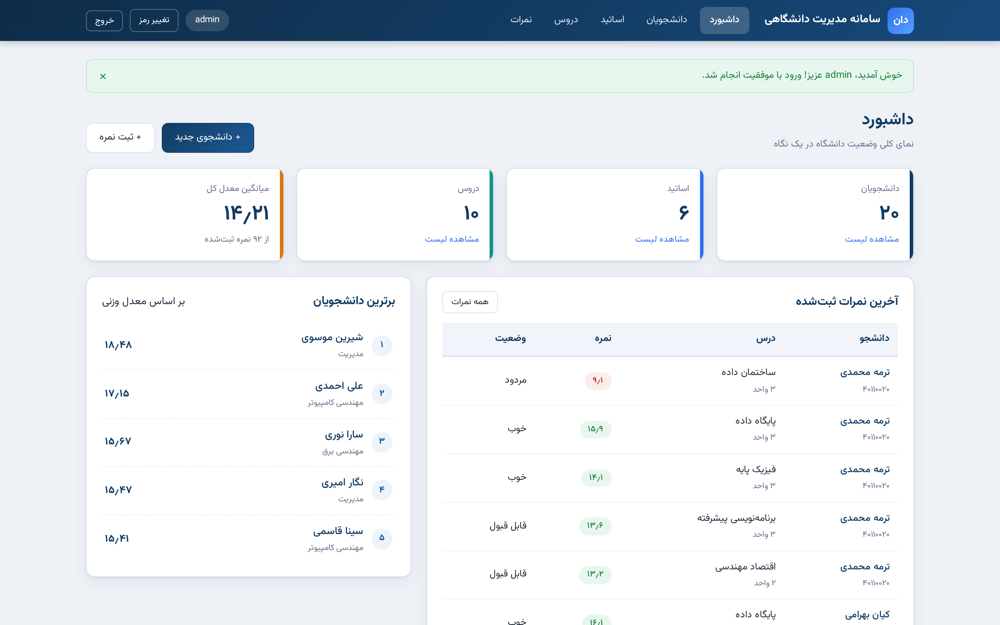
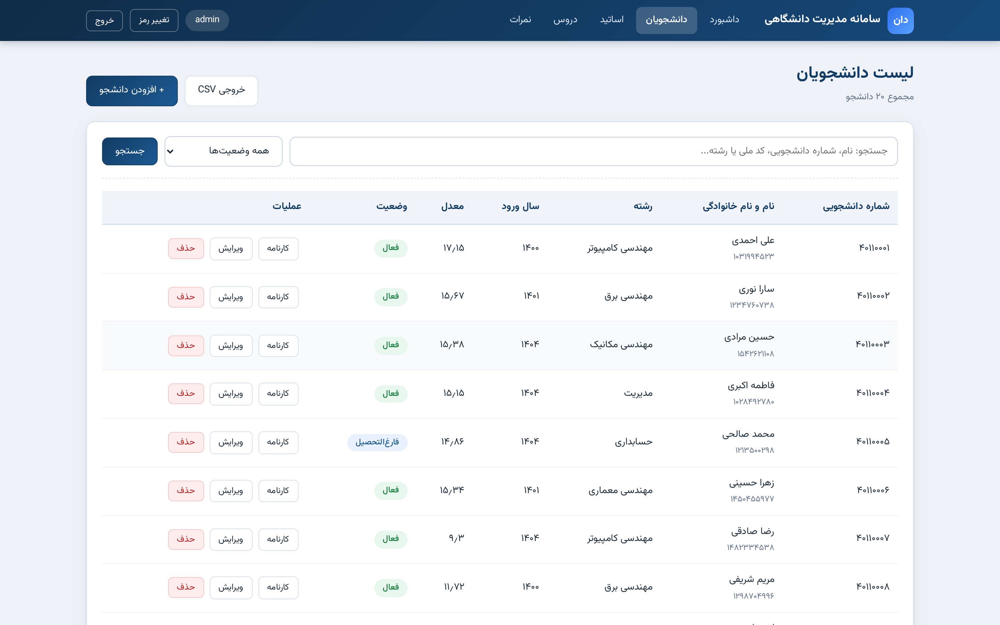
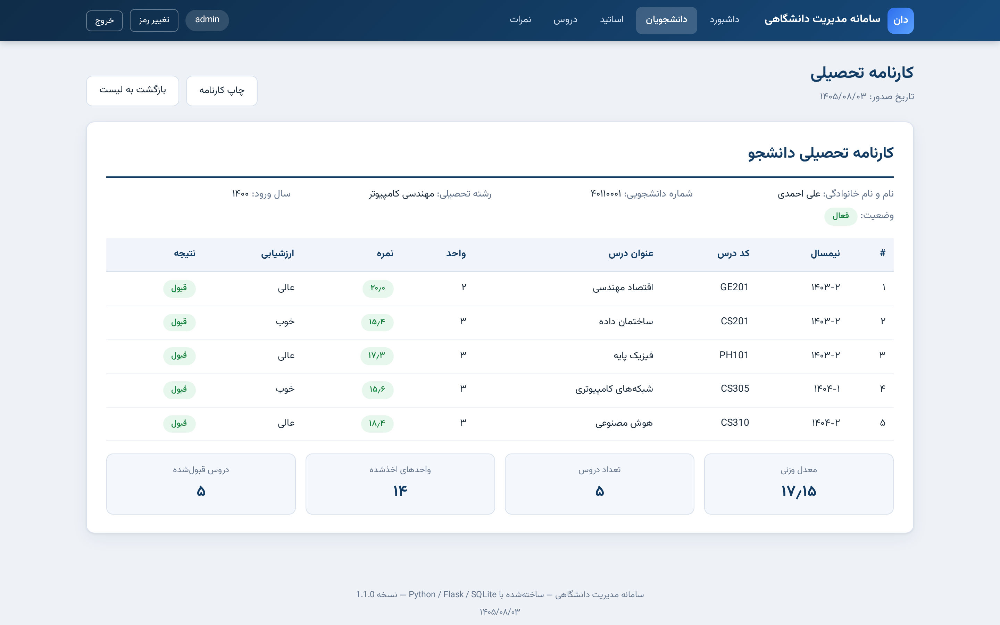
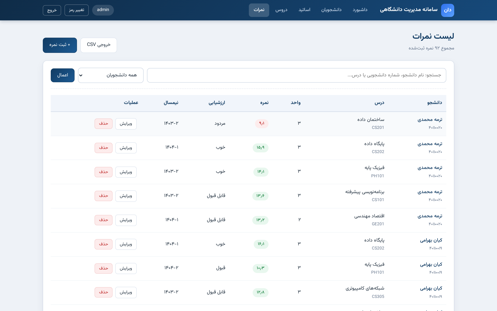

# سامانه مدیریت دانشگاهی (University Management System)


سامانه جامع و کامل مدیریت دانشگاه با رابط کاربری کاملاً **فارسی** و **راست‌به‌چپ (RTL)** — ساخته‌شده با Python / Flask / SQLite.

این پروژه شامل مدیریت دانشجویان، اساتید، دروس و نمرات به‌همراه **محاسبه خودکار معدل وزنی**، کارنامه تحصیلی، جستجو، صفحه‌بندی، خروجی CSV سازگار با اکسل فارسی و لایه‌های امنیتی چندلایه است.

---

## ✨ امکانات

| بخش | قابلیت‌ها |
|------|-----------|
| **احراز هویت** | ورود امن مدیر، هش رمز عبور (scrypt/pbkdf2)، محافظت کامل صفحات با `login_required` |
| **امنیت** | توکن CSRF برای همه فرم‌های POST، اعتبارسنجی سمت سرور همه ورودی‌ها |
| **داشبورد** | آمار زنده (تعداد دانشجو/استاد/درس/نمره)، میانگین معدل کل، برترین دانشجویان، آخرین نمرات |
| **دانشجویان** | افزودن/ویرایش/حذف، جستجو (نام، شماره دانشجویی، کد ملی، رشته)، فیلتر وضعیت، صفحه‌بندی |
| **اساتید** | CRUD کامل + نمایش تعداد دروس هر استاد |
| **دروس** | CRUD کامل + اتصال به استاد + واحد و نیمسال ارائه |
| **نمرات** | ثبت/ویرایش/حذف نمره (۰ تا ۲۰)، جلوگیری از ثبت تکراری، محاسبه لحظه‌ای معدل |
| **کارنامه** | صفحه چاپ‌پذیر شامل نمرات، ارزشیابی (عالی/خوب/...)، قبولی/مردودی و معدل وزنی |
| **خروجی CSV** | دانشجویان و نمرات با UTF-8 BOM (سازگار با Excel فارسی)، همراه با اعمال فیلترهای جستجو |
| **داده نمونه** | در اولین اجرا به‌صورت خودکار: ۲۰ دانشجو، ۶ استاد، ۱۰ درس و نمرات نمونه |
| **تغییر رمز عبور** | صفحه اختصاصی تغییر رمز با اعتبارسنجی (حداقل ۸ کاراکتر، تطبیق تکرار، عدم تکرار رمز فعلی) |
| **صفحات خطا** | صفحات فارسی اختصاصی برای خطاهای ۴۰۰، ۴۰۴ و ۵۰۰ |
| **مانیتورینگ** | اندپوینت `/health` برای بررسی سلامت و شماره نسخه سامانه |

### محاسبه معدل وزنی

```
معدل = مجموع (نمره × واحد درس) ÷ مجموع واحدهای اخذشده
```

مثال: نمره ۱۸ در درس ۳ واحدی و نمره ۱۲ در درس ۲ واحدی → (۱۸×۳ + ۱۲×۲) ÷ ۵ = **۱۵٫۶**

---

## 🛠 تکنولوژی‌ها

- **Python 3.8+**
- **Flask 3** — چارچوب وب
- **Flask-SQLAlchemy 3** (SQLAlchemy 2) — ORM
- **SQLite** — پایگاه داده (بدون نیاز به نصب)
- **HTML5 / CSS3 / JavaScript** — رابط کاربری RTL با فونت وزیرمتن (لوکال، بدون نیاز به اینترنت)
- **pytest** — تست خودکار (۶۵ تست)

---

## 📸 تصاویر محیط برنامه

| داشبورد | لیست دانشجویان |
|:---:|:---:|
|  |  |
| **کارنامه تحصیلی** | **ثبت نمره** |
|  |  |

> تصاویر کامل‌تر در پوشه [`docs/screenshots`](docs/screenshots) قرار دارند.

## 🎬 ویدیوی دمو

فایل ویدیوی معرفی و گشت‌وگذار کامل در سامانه: [`docs/demo.mp4`](docs/demo.mp4) — شامل ورود، داشبورد، لیست دانشجویان، کارنامه، نمرات، دروس، اساتید و خروج.

---

## 📁 ساختار پروژه

```
university-management-system/
├── app.py                    # نقطه ورود برنامه
├── config.py                 # پیکربندی
├── seed.py                   # اسکریپت ایجاد داده نمونه
├── requirements.txt          # وابستگی‌ها
├── requirements-dev.txt      # وابستگی‌های توسعه (تست)
├── run.bat                   # اجرای یک‌کلیکی در ویندوز
├── DEPLOY.md                 # راهنمای استقرار روی GitHub
├── CHANGELOG.md              # تاریخچه نسخه‌ها
├── .github/workflows/tests.yml  # CI: اجرای خودکار تست‌ها
├── docs/
│   ├── demo.mp4              # ویدیوی دمو
│   └── screenshots/          # تصاویر صفحات سامانه
├── university/
│   ├── __init__.py           # Application Factory + ایجاد خودکار مدیر و داده نمونه
│   ├── models.py             # مدل‌ها: Admin, Student, Teacher, Course, Grade
│   ├── forms.py              # اعتبارسنجی سمت سرور
│   ├── utils.py              # CSRF، فیلترهای قالب (ارقام فارسی، تاریخ شمسی)، CSV
│   ├── jalali.py             # تبدیل تاریخ میلادی → شمسی
│   ├── seed_data.py          # داده نمونه واقع‌گرایانه
│   ├── routes/               # Blueprintها: auth, dashboard, students, teachers, courses, grades
│   ├── templates/            # قالب‌های Jinja2 (RTL) + صفحات خطا
│   └── static/               # CSS، JS، فونت وزیرمتن
└── tests/                    # ۶۵ تست خودکار pytest
```

---

## 🚀 نصب و اجرا در ویندوز (روش آسان)

> پیش‌نیاز: [Python 3.8 یا جدیدتر](https://www.python.org/downloads/) — هنگام نصب تیک **Add python.exe to PATH** را بزنید.

1. پروژه را دانلود و در پوشه‌ای استخراج کنید.
2. روی فایل **`run.bat`** دابل‌کلیک کنید.
3. پنجره کنسول باز می‌ماند و برنامه اجرا می‌شود:
   - آدرس: **http://127.0.0.1:5000**
   - نام کاربری: **admin** — رمز عبور: **admin123**

> نکته: در اولین اجرا، محیط مجازی ساخته و وابستگی‌ها نصب می‌شوند (نیاز به اینترنت است؛ فقط بار اول).

## 🚀 نصب و اجرا در ویندوز (روش دستی)

```bat
cd university-management-system
python -m venv .venv
.venv\Scripts\activate
pip install -r requirements.txt
python app.py
```

سپس مرورگر را روی `http://127.0.0.1:5000` باز کنید.

## 🐧 نصب و اجرا در لینوکس / مک

```bash
cd university-management-system
python3 -m venv .venv
source .venv/bin/activate
pip install -r requirements.txt
python app.py
```

---

## 👤 حساب پیش‌فرض

| فیلد | مقدار |
|------|-------|
| نام کاربری | `admin` |
| رمز عبور | `admin123` |

> ⚠️ **هشدار امنیتی:** این رمز فقط برای شروع است. قبل از استفاده واقعی، در فایل `university/__init__.py` مقدار `admin123` را تغییر دهید و برای محیط عملیاتی یک `SECRET_KEY` قوی در متغیر محیطی تنظیم کنید:
> ```
> set SECRET_KEY=یک-رشته-تصادفی-بلند     (ویندوز CMD)
> export SECRET_KEY="یک-رشته-تصادفی-بلند"  (لینوکس/مک)
> ```

---

## 🧪 اجرای تست‌های خودکار

```bash
pip install -r requirements.txt -r requirements-dev.txt
pytest -v
```

خروجی مورد انتظار: **65 passed**

تست‌ها شامل: ورود/خروج و محافظت صفحات، هش رمز عبور، CSRF، قفل ورود پس از تلاش‌های ناموفق (brute-force)، تغییر رمز عبور، هدرهای امنیتی، صفحات خطا، اندپوینت سلامت، CRUD دانشجو/استاد/درس/نمره، اعتبارسنجی ورودی‌ها، جستجو، صفحه‌بندی، محاسبه معدل وزنی، کارنامه، خروجی CSV با BOM و تبدیل تاریخ شمسی.

---

## 📤 خروجی CSV

- دکمه «خروجی CSV» در صفحه دانشجویان: با اعمال فیلترهای جستجوی فعال
- دکمه «خروجی CSV» در صفحه نمرات: کل نمرات با نام دانشجو و درس
- فایل‌ها با کدگذاری **UTF-8 با BOM** ذخیره می‌شوند تا در Microsoft Excel فارسی بدون به‌هم‌ریختگی باز شوند.

---

## 🔄 به‌روزرسانی روی GitHub

راهنمای کامل انتشار و به‌روزرسانی کد روی GitHub در فایل **[DEPLOY.md](DEPLOY.md)** آمده است. خلاصه:

```bash
git add .
git commit -m "توضیح تغییرات"
git push origin main
```

---

## 🔒 نکات امنیتی

- رمزهای عبور با `werkzeug.security` هش می‌شوند (هرگز متن ساده ذخیره نمی‌شود).
- تمام فرم‌های POST با توکن CSRF محافظت می‌شوند؛ درخواست بدون توکن با خطای ۴۰۰ رد می‌شود.
- همه صفحات (به‌جز ورود) با `login_required` محافظت می‌شوند.
- **محافظت brute-force:** پس از ۵ تلاش ناموفق ورود، IP برای ۱۲۰ ثانیه قفل می‌شود (با پیام شفاف و ثبت در لاگ).
- **هدرهای امنیتی** روی همه پاسخ‌ها: `Content-Security-Policy`، `X-Frame-Options: DENY`، `X-Content-Type-Options: nosniff`، `Referrer-Policy: no-referrer`.
- کوکی نشست با `HttpOnly` و `SameSite=Lax` محافظت می‌شود و پس از ۸ ساعت منقضی می‌گردد.
- تلاش‌های ناموفق ورود و تغییرات رمز در لاگ برنامه ثبت می‌شوند.
- ورودی‌ها در سمت سرور اعتبارسنجی می‌شوند (شماره دانشجویی، کد ملی، ایمیل، نمره ۰ تا ۲۰، واحد ۱ تا ۶ و...).
- **هیچ رمز عبور یا توکن واقعی در کد یا ریپازیتوری قرار ندارد.**

---

## 📄 مجوز

این پروژه تحت مجوز MIT منتشر شده و برای مقاصد آموزشی آزاد است.
